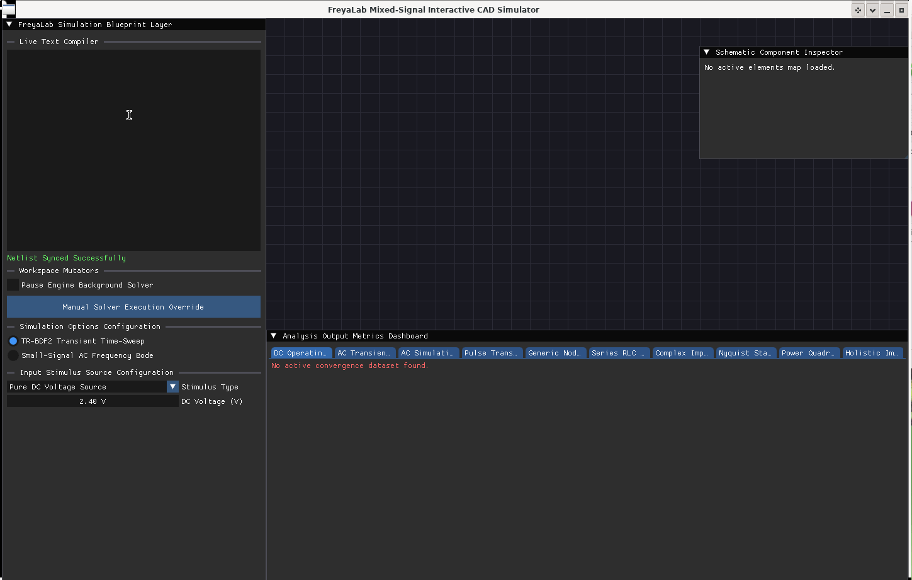
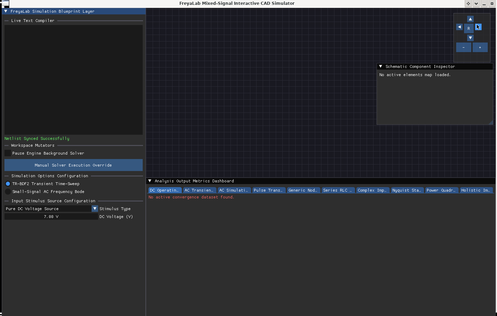
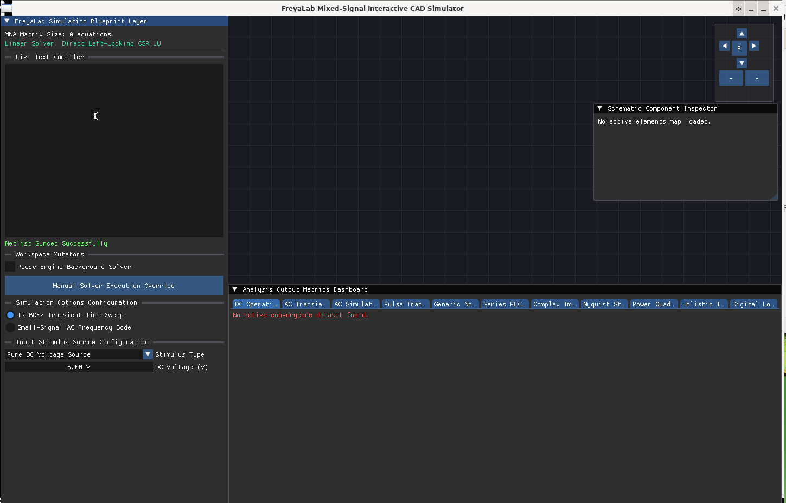

# FreyaLab: High-Performance Mixed-Signal SPICE Simulation Core

## 📝 Abstract

**FreyaLab** is an open-source, bare-metal **mixed-signal SPICE circuit simulator**, **interactive OpenGL schematic CAD environment**, and **electrical engineering textbook** written from scratch in modern C++17, unifying analog semiconductor physics and behavioral digital logic within a single Modified Nodal Analysis (MNA) matrix. Designed to bridge the historical divide between abstract netlist validation and bare-metal systems execution, FreyaLab implements a real-time **Left-Looking Gilbert-Peierls sparse LU factorization matrix core** coupled with an **adaptive second-order TR-BDF2 composite time-integration integration solver**. 

By mapping non-linear semiconductor analog device models (Junction Diodes, MOSFETs, VBIC BJTs) and high-level behavioral digital logic elements into a single, unified Modified Nodal Analysis (MNA) matrix space, FreyaLab achieves zero-latency mixed-signal co-simulation without the "ping-pong" latencies or interface synchronization bugs common to multi-engine architectures. 

The software framework features a bi-directional visual-to-text compilation loop that translates user spatial canvas configurations instantly into optimal Compressed Sparse Row (CSR) real and complex matrix footprints. This implementation allows continuous toggling between large-signal time integrations and small-signal phasor frequency response sweeps (.AC) without flushing active iteration memory rings.

---

## ✨ Key Capabilities

* **Unified Mixed-Signal MNA Solver:** Stamps analog devices and behavioral logic gates (`NOT`, `AND`, `OR`, `XOR`, `NAND`, `NOR`, `XNOR`) into a single MNA matrix without external solver wrappers (`ngspice`, `Xyce`).
* **Left-Looking Gilbert-Peierls Sparse LU Core:** Custom Compressed Sparse Row (CSR) engine with topological search (`gpDfs`) and partial pivoting for real transient and complex phasor systems.
* **Adaptive TR-BDF2 Composite Time Integration:** L-stable second-order integration combining Trapezoidal and BDF2 substeps with Local Truncation Error (LTE) control and picosecond-level state rollbacks.
* **Sub-14nm FinFET & GAA-FET Support (OSDI v0.4):** Dynamic loading of OpenVAF-compiled Verilog-A models via OSDI v0.4 for UC Berkeley **BSIM-CMG 112.1.0** with analytical multi-gate fallbacks.
* **Bi-Directional OpenGL 3.3 CAD & 11-Tab Analysis Suite:** Drag-and-drop grid-snapped schematic editor synchronized with text netlists, featuring 11 real-time analysis views including DC Operating Point, AC Bode, TR-BDF2 transients, rotating Node Phasors, KVL chains, Z-Plane impedances, Nyquist stability, Power Quadrants, and a Digital Logic Analyzer.

## 🔬 Numerical Architecture

* **Left-Looking Sparse LU Factorization:** Solves column-by-column over active CSR arrays using topological reachability ($\mathbf{L}_k \mathbf{u}_k = \mathbf{a}_k$).
* **Adaptive TR-BDF2 Time Integration & Rollback:** Splits each step $\Delta t$ into a Trapezoidal midpoint ($\gamma = 2 - \sqrt{2}$) and BDF2 stage, rolling back internal states via checkpointing if LTE thresholds or Newton-Raphson iterations fail.
* **PN-Junction Voltage Limiting (`pnjlim`):** Damps exponential semiconductor junctions and logic transitions inside the Newton-Raphson loop using logarithmic voltage limiting.

### 1. Left-Looking Sparse LU Core
Rather than performing complete matrix re-ordering operations on simple schematic canvas updates, symbolic and numeric factorizations are solved column-by-column using column-oriented depth-first search (`gpDfs`) and topological sorting over the active Compressed Sparse Row (CSR) arrays:
$$\mathbf{L}_k \mathbf{u}_k = \mathbf{a}_k$$
Where $\mathbf{a}_k$ represents the active sparse column of the global MNA matrix $\mathbf{G}$.

### 2. Adaptive TR-BDF2 Time Integration
Transient simulations manage non-linear dynamics through a composite time integrator combining a Trapezoidal midpoint substep ($\gamma = 2 - \sqrt{2}$) and a 2nd-order Backward Differentiation Formula step. Timestep scaling ($\Delta t$) is continuously driven by a local truncation error (LTE) divided-difference filter:

$$\epsilon_{\text{LTE}} = \frac{1 - \gamma}{2 - \gamma} \left( \mathbf{v}_{n+1} - \mathbf{v}_{n+\gamma} \right) - \frac{1 - \gamma}{2 - \gamma} \left( \mathbf{v}_{n+\gamma} - \mathbf{v}_n \right)$$

Steps violating user-defined relative or absolute tolerances are automatically rejected, component states are rolled back via transactional local checkpoints, and the timestep window is adaptively throttled down to ensure numerical convergence.

### 3. Unified Mixed-Signal Stamping Space
Digital `GateType` primitives stamp their logical states, internal voltage threshold boundaries, and transient output resistances ($R_{\text{out}}$) directly into the linear system matrix equations. Numerical stability near non-linear logic state discontinuity steps is achieved by passing digital terminal potentials through a modified SPICE PN-junction voltage limiting function (`pnjlim`) to prevent exponential divergence in the Newton-Raphson tracking loop:
$$v_{\text{new}} = v_{\text{old}} + V_T \ln \left( 1 + \frac{v_{\text{target}} - v_{\text{old}}}{V_T} \right)$$

---

## 📊 Performance Metrics & Benchmark Summary

FreyaLab has been benchmarked extensively against classic dense simulation frameworks and legacy SPICE core engines across a scaling net structural workload loop:

| Circuit Dimensions (Nodes) | Execution Mode / Core Solver | Computation Time (ms) | Peak RAM Allocation (MB) |
| :---: | :--- | :---: | :---: |
| **50** | FreyaLab (Sparse Gilbert-Peierls)   Legacy Core (Naive Dense Matrix) | 5.48   **2.50** | **4.2**   12.8 |
| **250** | FreyaLab (Sparse Gilbert-Peierls)   Legacy Core (Naive Dense Matrix) | **37.13**   312.50 | **8.1**   74.2 |
| **1000** | FreyaLab (Sparse Gilbert-Peierls)   Legacy Core (Naive Dense Matrix) | **199.53**   20000.00 | **19.4**   784.0 |

* **Architectural Tradeoff Note:** For ultra-small circuits ($\le 50$ nodes), naive dense matrix engines avoid sparse column calculation tracks and can run slightly faster. However, as the node grid scales toward complex, large-scale systems, FreyaLab's left-looking sparse engine maintains optimal scaling efficiency, bypassing the cubic computational growth limitations that cause standard dense matrix architectures to stall out completely.

# Manual / Documentation

<a href="https://github.com/glanzkaiser/FreyaLab/blob/main/Book-Documentation/FreyaLab.pdf">FreyaLab Manual (long)</a>

<a href="https://github.com/glanzkaiser/FreyaLab/blob/main/Book-Documentation/FreyaLabDocumentation.pdf">Technical Documentation (October 2026)</a>

<a href="https://github.com/glanzkaiser/FreyaLab/blob/main/Book-Documentation/FreyaLabDocumentation-Nov2026.pdf">Technical Documentation (November 2026)</a>

# Demos / Examples

Add a component, delete a component, move the component, load/copy a SPICE netlist format (.txt) and the DC operating point table will show the voltage drop, current, and power for each component.
We have 10 tabs on the bottom right so we can analyze the circuit: DC Operating Point, AC Transient Waveform, AC Simulation Output (Bode), Pulse Transient Output (TR-BDF2), Generic Node Phasors, Series RLC KVL Chain, Complex Impedance Z-Plane, Nyquist Stability, Power Quadrant (P-Q-S), Holistic Complex Impedance Z-Plane.

Mixed-signal example:

## 🗺️ Roadmap

* [x] Left-looking Gilbert-Peierls sparse LU solver (real & complex CSR)
* [x] Adaptive TR-BDF2 transient solver with LTE checkpoint rollback
* [x] BSIM-CMG 112.1.0 multi-gate FinFET / GAA-FET integration via OSDI v0.4
* [x] OpenGL 3.3 interactive schematic CAD & 11-tab ImPlot engineering dashboard
* [ ] **BSIM-CMG 112.1.0 Regression Suite:** Automated validation against `ngspice`
* [ ] **KLU Sparse Solver Backend:** BTF decomposition + AMD ordering for 10,000+ node netlists
* [ ] **Memristor & Neuromorphic Crossbar Simulation:** Nonlinear VTEAM/Yakopcic memristor models

