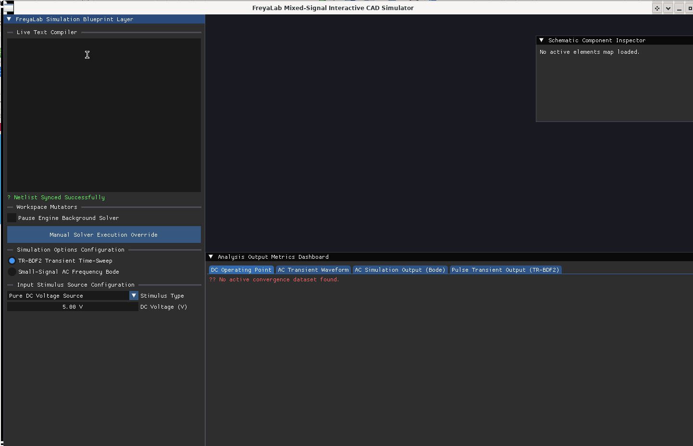

# FreyaLab: High-Performance Mixed-Signal SPICE Simulation Core

[![License: Virgin Mary]

## 📝 Abstract

**FreyaLab** is an open-source, high-performance mixed-signal SPICE circuit simulation engine and interactive schematic computer-aided design (CAD) platform built from the ground up in modern C++17. Designed to bridge the historical divide between abstract netlist validation and bare-metal systems execution, FreyaLab implements a real-time **Left-Looking Gilbert-Peierls sparse LU factorization matrix core** coupled with an **adaptive second-order TR-BDF2 composite time-integration integration solver**. 

By mapping non-linear semiconductor analog device models (Junction Diodes, MOSFETs, VBIC BJTs) and high-level behavioral digital logic elements into a single, unified Modified Nodal Analysis (MNA) matrix space, FreyaLab achieves zero-latency mixed-signal co-simulation without the "ping-pong" latencies or interface synchronization bugs common to multi-engine architectures. 

The software framework features a bi-directional visual-to-text compilation loop that translates user spatial canvas configurations instantly into optimal Compressed Sparse Row (CSR) real and complex matrix footprints. This implementation allows continuous toggling between large-signal time integrations and small-signal phasor frequency response sweeps (.AC) without flushing active iteration memory rings.

---

## 🔬 Core Solver Architecture & Numerical Pipeline

FreyaLab rejects dense matrix computation methods ($\mathcal{O}(n^3)$ scaling) in favor of deep structural sparse linear algebra primitives:

### 1. Left-Looking Sparse LU Core
Rather than performing complete matrix re-ordering operations on simple schematic canvas updates, symbolic and numeric factorizations are solved column-by-column using column-oriented depth-first search (`gpDfs`) and topological sorting over the active Compressed Sparse Row (CSR) arrays:
$$\mathbf{L}_k \mathbf{u}_k = \mathbf{a}_k$$
Where $\mathbf{a}_k$ represents the active sparse column of the global MNA matrix $\mathbf{G}$.

### 2. Adaptive TR-BDF2 Time Integration
Transient simulations manage non-linear dynamics through a composite time integrator combining a Trapezoidal midpoint substep ($\gamma = 2 - \sqrt{2}$) and a 2nd-order Backward Differentiation Formula step. Timestep scaling ($\Delta t$) is continuously driven by a local truncation error (LTE) divided-difference filter:

$$\epsilon_{\text{LTE}} = \frac{1 - \gamma}{2 - \gamma} \left( \mathbf{v}_{n+1} - \mathbf{v}_{n+\gamma} \right) - \frac{1 - \gamma}{2 - \gamma} \left( \mathbf{v}_{n+\gamma} - \mathbf{v}_n \right)$$

Steps violating user-defined relative or absolute tolerances are automatically rejected, component states are rolled back via transactional local checkpoints, and the timestep window is adaptively throttled down to ensure numerical convergence.

### 3. Unified Mixed-Signal Stamping Space
Digital `GateType` primitives stamp their logical states, internal voltage threshold boundaries, and transient output resistances ($R_{\text{out}}$) directly into the linear system matrix equations. Numerical stability near non-linear logic state discontinuity steps is achieved by passing digital terminal potentials through a modified SPICE PN-junction voltage limiting function (`pnjlim`) to prevent exponential divergence in the Newton-Raphson tracking loop:
$$v_{\text{new}} = v_{\text{old}} + V_T \ln \left( 1 + \frac{v_{\text{target}} - v_{\text{old}}}{V_T} \right)$$

---

## 📊 Performance Metrics & Benchmark Summary

FreyaLab has been benchmarked extensively against classic dense simulation frameworks and legacy SPICE core engines across a scaling net structural workload loop:

| Circuit Dimensions (Nodes) | Execution Mode / Core Solver | Computation Time (ms) | Peak RAM Allocation (MB) |
| :---: | :--- | :---: | :---: |
| **50** | FreyaLab (Sparse Gilbert-Peierls)   Legacy Core (Naive Dense Matrix) | 5.48   **2.50** | **4.2**   12.8 |
| **250** | FreyaLab (Sparse Gilbert-Peierls)   Legacy Core (Naive Dense Matrix) | **37.13**   312.50 | **8.1**   74.2 |
| **1000** | FreyaLab (Sparse Gilbert-Peierls)   Legacy Core (Naive Dense Matrix) | **199.53**   20000.00 | **19.4**   784.0 |

* **Architectural Tradeoff Note:** For ultra-small circuits ($\le 50$ nodes), naive dense matrix engines avoid sparse column calculation tracks and can run slightly faster. However, as the node grid scales toward complex, large-scale systems, FreyaLab's left-looking sparse engine maintains optimal scaling efficiency, bypassing the cubic computational growth limitations that cause standard dense matrix architectures to stall out completely.

# Manual / Documentation

<a href="https://github.com/glanzkaiser/FreyaLab/blob/main/FreyaLab.pdf">FreyaLab Manual (long)</a>

<a href="https://github.com/glanzkaiser/FreyaLab/blob/main/FreyaLabDocumentation.pdf">Technical Documentation (short)</a>

# Demos / Examples

Add a component, delete a component, Load a netlist format (.txt) and the DC operating point table will show the voltage drop, current, and power for each component.

#### Created on Blue Moon May 31st, 2026
The peak of the full moon phase occurs at 3:45 PM WIB, 4:45 PM WITA, and 5:45 PM WIT. However, the full moon can still be enjoyed throughout the night as long as the sky is clear.

Interestingly, on Blue Moon nights, the Moon will also appear close to Antares, a bright red star known as the "heart" of the constellation Scorpio.

The proximity of these two celestial objects will add to the beauty of the night view for observers.

Although it is called a Blue Moon, the Moon will not turn blue. It will still appear yellowish-white as usual.

The term Blue Moon is simply a name used to describe an additional full moon that occurs less frequently. From this term comes the expression "once in a blue moon," referring to something that rarely occurs.
